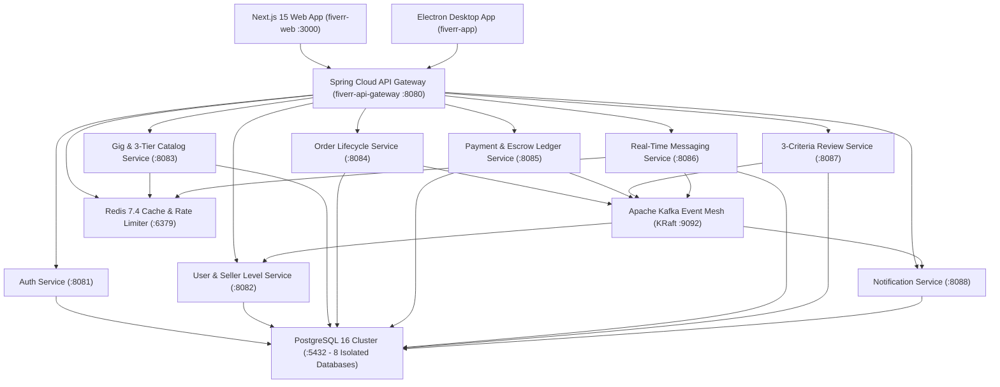
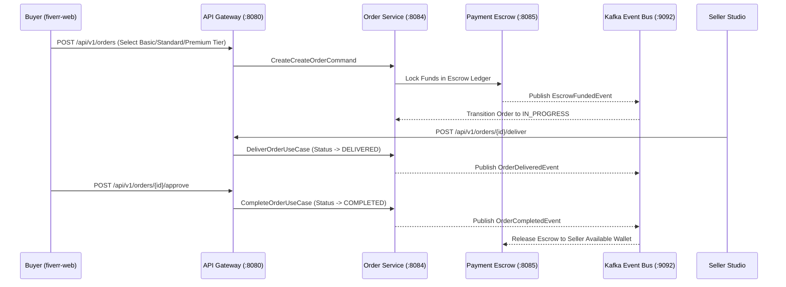

# Fiverr Club — Cloud-Native Freelance Marketplace Ecosystem

Welcome to **Fiverr Club** (`@fiverr-club`), an enterprise-grade, cloud-native Freelance Services & Escrow Marketplace engineered with **Java 21**, **Spring Boot 3**, **Domain-Driven Design (DDD)**, **Hexagonal Architecture (Ports & Adapters)**, **Apache Kafka (KRaft)**, **Next.js 15 (App Router)**, and **Kubernetes / Helm v3**.

---

## System Architecture



---

## Escrow & Order Saga Workflow



---

## Complete Repository Catalog (13 Repositories)

| Repository | Port / Production HTTPS | Tech Stack | Domain Responsibility |
|---|---|---|---|
| [`fiverr-web`](https://github.com/fiverr-club/fiverr-web) | `3000` · [https://fiverr-web-seven.vercel.app](https://fiverr-web-seven.vercel.app) | Next.js 15, React 19, TypeScript, Tailwind CSS | Marketplace Catalog, 3-Tier Gig Configurator, Escrow Order Workspace, Seller Studio, Real-Time Inbox |
| [`fiverr-app`](https://github.com/fiverr-club/fiverr-app) | Desktop (`Electron`) | Electron 34, React 19, TypeScript, Vite, Tailwind CSS | Cross-Platform Desktop Workstation, Context-Isolated Preload IPC, Native Escrow Receipt Export, Live DDD Cluster Telemetry |
| [`fiverr-technical-doc`](https://github.com/fiverr-club/fiverr-technical-doc) | `3001` · [https://fiverr-technical-doc.vercel.app](https://fiverr-technical-doc.vercel.app) | Next.js 15, Markdown, Mermaid, TypeScript | Interactive Technical Documentation Portal, DDD/Hexagonal Deep-Dive, 28-API Reference, Kafka Saga & DB Schemas |
| [`fiverr-api-gateway`](https://github.com/fiverr-club/fiverr-api-gateway) | `8080` | Spring Cloud Gateway, Redis, JWT | Unified API Edge Routing, JWT Verification, Distributed Rate Limiting, CORS |
| [`fiverr-auth-service`](https://github.com/fiverr-club/fiverr-auth-service) | `8081` | Java 21, Spring Boot 3, PostgreSQL | Identity Registration, Credentials, Access & Refresh Token Issuance, Role Management |
| [`fiverr-user-service`](https://github.com/fiverr-club/fiverr-user-service) | `8082` | Java 21, Spring Boot 3, PostgreSQL | Freelancer & Buyer Profiles, Skills, Languages, Seller Level Evaluation (`New`, `Level 1`, `Level 2`, `Top Rated`) |
| [`fiverr-gig-service`](https://github.com/fiverr-club/fiverr-gig-service) | `8083` | Java 21, Spring Boot 3, PostgreSQL, Redis | Gig Catalog, 3-Tier Pricing Packages (`Basic`, `Standard`, `Premium`), Search & Category Filtering |
| [`fiverr-order-service`](https://github.com/fiverr-club/fiverr-order-service) | `8084` | Java 21, Spring Boot 3, PostgreSQL, Kafka | Order State Machine (`IN_PROGRESS`, `DELIVERED`, `REVISION_REQUESTED`, `COMPLETED`), Deadlines & Deliverables |
| [`fiverr-payment-service`](https://github.com/fiverr-club/fiverr-payment-service) | `8085` | Java 21, Spring Boot 3, PostgreSQL, Kafka | Escrow Deposit Ledger, Platform Service Fee Calculation (5.5%), Escrow Release & Seller Payouts |
| [`fiverr-messaging-service`](https://github.com/fiverr-club/fiverr-messaging-service) | `8086` | Java 21, Spring Boot 3, PostgreSQL, Redis | Buyer-Seller Conversation Threads, File Attachments, Custom Milestone Offers |
| [`fiverr-review-service`](https://github.com/fiverr-club/fiverr-review-service) | `8087` | Java 21, Spring Boot 3, PostgreSQL, Kafka | Verified Buyer Reviews, 3-Criteria Breakdown (`Communication`, `Service as Described`, `Recommend`) |
| [`fiverr-notification-service`](https://github.com/fiverr-club/fiverr-notification-service) | `8088` | Java 21, Spring Boot 3, PostgreSQL, Kafka | Event-Driven Email, Push & In-App Alerts for Order, Escrow, and Messaging Events |
| [`fiverr-k8s-infra`](https://github.com/fiverr-club/fiverr-k8s-infra) | — | Kubernetes, Kustomize, Helm v3, Docker Compose | StatefulSets (Postgres, Redis, Kafka KRaft), 10 Deployments + HPAs, NGINX Ingress TLS, NetworkPolicies |
| [`.github`](https://github.com/fiverr-club/.github) | — | GitHub Organization Profile | Organization Architecture Overview & Repository Index |

---

## Strict DDD & Hexagonal Architecture Standard

All backend microservices in `fiverr-club` enforce a strict **Domain-Driven Design (DDD)** and **Hexagonal Architecture (Ports and Adapters)** standard:

1. **Repository Interfaces in Domain Layer (`domain/repository/`)**:
   - Repository contracts (`UserRepository`, `GigRepository`, `OrderRepository`, `EscrowPaymentRepository`, etc.) **always** reside in `domain/repository/`.
   - They are **never** placed in `application/port/out/`.
2. **Infrastructure Persistence Adapters (`infrastructure/persistence/repository/`)**:
   - `Jpa{Entity}Repository` implements the domain repository interface and delegates to `{Entity}JpaRepository` (Spring Data JPA).
3. **Use Case Pattern (`application/port/in/` & `application/usecase/`)**:
   - Every business operation is modeled as a single-responsibility Use Case (`{Action}{Entity}UseCase` & `{Action}{Entity}UseCaseImpl`) accepting a `Command` DTO and returning a `Result` DTO.
4. **External Service Ports (`application/port/out/`)**:
   - Reserved strictly for non-repository external integrations (e.g., `PasswordEncoderPort`, `TokenGeneratorPort`, `PaymentGatewayPort`, `EventPublisherPort`, `EmailSenderPort`).

```text
src/main/java/club/fiverr/{module}/
├── presentation/rest/              # Controllers, Request/Response DTOs, REST Mappers
├── application/
│   ├── dto/command/                # Immutable input Command records
│   ├── dto/result/                 # Immutable output Result records
│   ├── mapper/                     # Domain <-> Result Mappers
│   ├── port/in/                    # Inbound Use Case Interfaces
│   ├── port/out/                   # Outbound External Service Ports (NO Repositories!)
│   └── usecase/                    # @Service Use Case Implementations
├── domain/
│   ├── model/                      # Rich Domain Aggregates, Entities & Value Objects
│   ├── repository/                 # Domain Repository Interfaces (ALWAYS HERE)
│   ├── service/                    # Pure Domain Services
│   └── exception/                  # Domain-Specific Exceptions
└── infrastructure/
    ├── persistence/
    │   ├── entity/                 # JPA @Entity classes
    │   ├── mapper/                 # JPA Entity <-> Domain Model Mappers
    │   └── repository/             # Jpa{Entity}Repository & {Entity}JpaRepository
    └── adapter/                    # Outbound Port Adapters (Kafka, Redis, JWT, SMTP)
```

---

## Kubernetes & Local Deployment Guide

### 1. Deploy Full Cluster with Kustomize
```bash
git clone https://github.com/fiverr-club/fiverr-k8s-infra.git
cd fiverr-k8s-infra
kubectl apply -k k8s/
```

### 2. Deploy with Helm v3 Umbrella Chart
```bash
helm upgrade --install fiverr-ecosystem ./helm/fiverr-ecosystem \
  --namespace fiverr-club \
  --create-namespace \
  -f ./helm/fiverr-ecosystem/values-prod.yaml
```

### 3. Run Locally with Docker Compose
```bash
docker compose up --build -d
```
